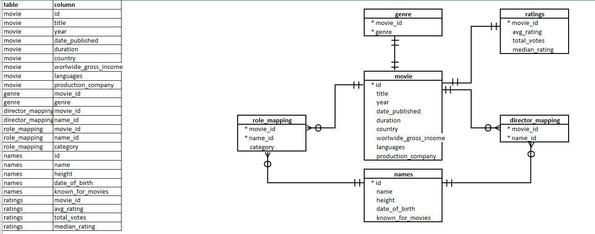

# RSVP Movies: SQL Analysis

SQL analysis of an IMDb movies database to recommend how RSVP Movies, an Indian production company, should plan a film for a global audience in 2022.

## Problem

RSVP Movies has made hit films for the Indian market and wants a data-driven plan for its next release. The analysis covers movies released over the past three years and is split into four segments, each answering business questions from a different combination of tables.

## Database

The schema is shown in the ERD below. `IMDB_dataset_import.sql` builds the database and loads the data; `IMDb+movies+Data+and+ERD+final.xlsx` holds the source tables and the ERD.

## Files

| File | Purpose |
| --- | --- |
| `RSVP MOVIES.sql` | Analysis queries, with the business question above each segment |
| `IMDB_dataset_import.sql` | Database creation and data load |
| `IMDb+movies+Data+and+ERD+final.xlsx` | Source data and table descriptions |
| `ERD.JPG` | Entity relationship diagram |

## Run it

1. Open MySQL Workbench
2. Run `IMDB_dataset_import.sql` to create and load the database
3. Run the queries in `RSVP MOVIES.sql`

## Stack

MySQL
